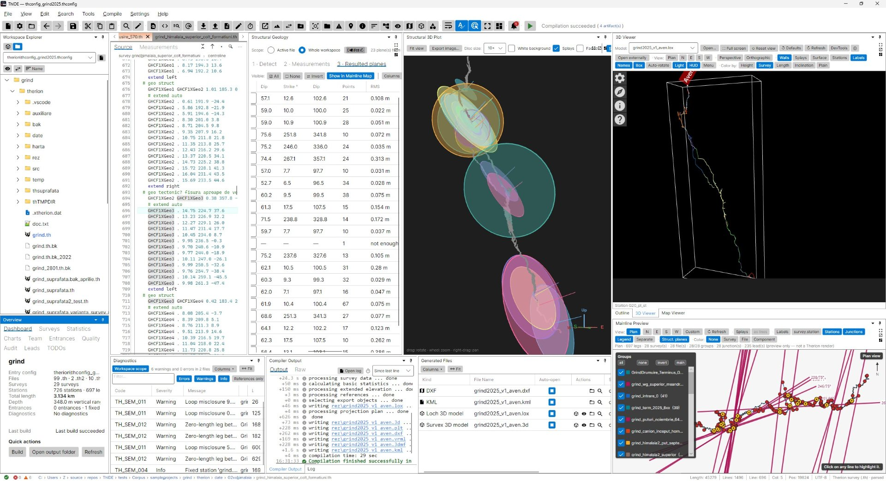
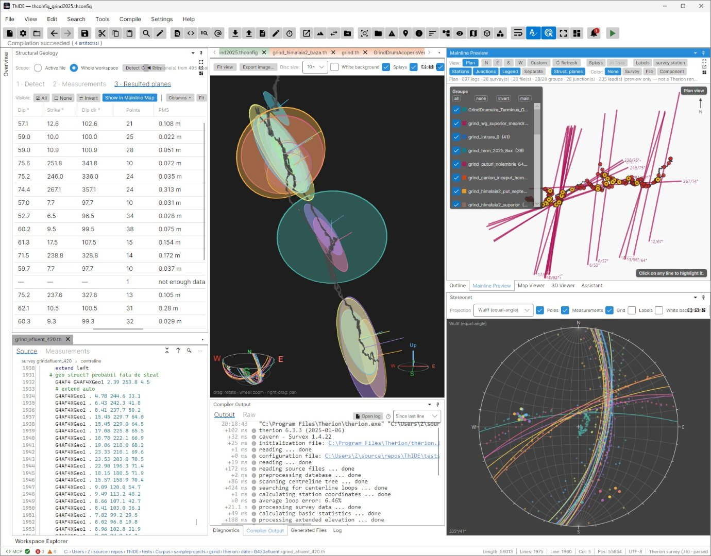
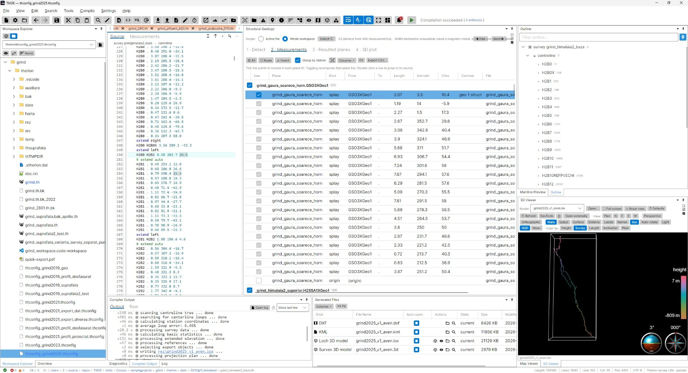
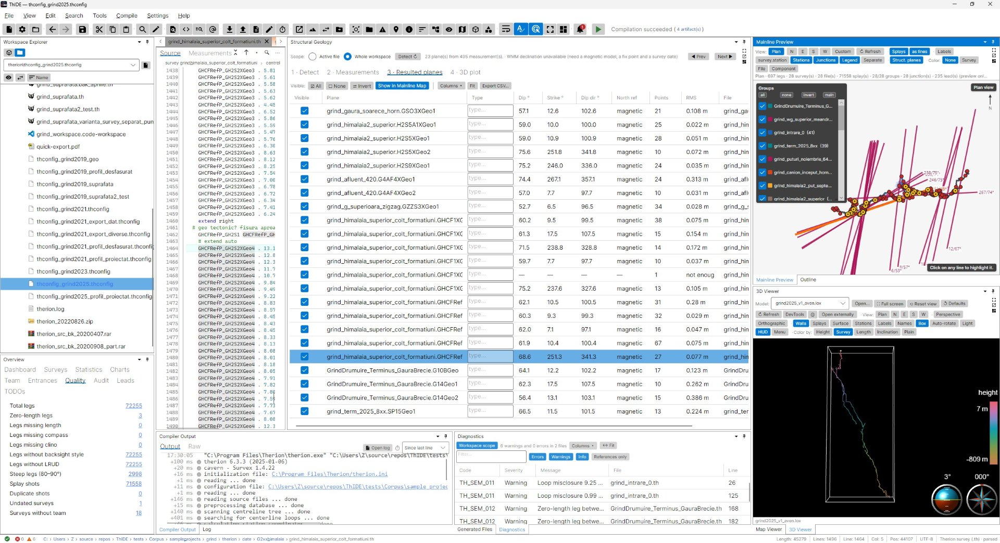

# Geologie structurală (calculator de direcție/înclinare a planelor)

Modulul Geologie structurală calculează orientarea — **direcția și înclinarea** (strike și dip) — a
structurilor geologice plane (plane de stratificație, falii, diaclaze) din vizări topografice Therion
obișnuite. Este succesorul integrat în aplicație al programului independent *TherionStructuralCalculator*.

## Ideea

Pentru a înregistra orientarea unui plan de rocă în subteran, topograful stă într-o stație și vizează
mai multe puncte aflate pe acea suprafață plană. Convertind aceste vizări în puncte 3D și **ajustând un
plan** prin ele, se obțin direcția și înclinarea planului — măsurători standard de geologie structurală.
Acest modul automatizează procesul pornind de la datele dumneavoastră `.th`.

Ajustarea planului este o **ajustare prin cele mai mici pătrate totale (PCA)**: minimizează distanța
ortogonală față de plan, deci este corectă pentru **orice** orientare, inclusiv plane verticale/abrupte
(spre deosebire de o regresie `z = a·x + b·y + c`). Mai multe puncte nu fac decât să îmbunătățească
rezultatul — costul calculului nu depinde de numărul lor.

## Activare

Modulul este **dezactivat implicit**. Activați-l în **Preferințe ▸ Compilare / Vizualizare ▸
„Modul Geologie structurală (calculator de direcție/înclinare a planelor)”**, apoi deschideți-l din
**Vizualizare ▸ Geologie structurală**. Panoul este un asistent în cinci pași prin care vă puteți
deplasa liber; modificarea unui pas anterior actualizează imediat tot ce urmează.

### 1 · Detectare

Alegeți domeniul (fișierul activ sau întregul proiect) și modul în care sunt recunoscute vizările
structurale. O vizare este structurală dacă îndeplinește **oricare** dintre semnalele activate:

- **Cuvânt cheie în numele stației (Station-name keyword)** — numele stației `from` conține un cuvânt
  cheie (implicit `geo`).
- **Marcaj în comentariu (Comment marker)** — comentariul vizei conține un marcaj (de ex. `# plane fault-A`).
- **Indicator de stație (Station flag)** — stația `from`/`to` poartă un indicator (flag) pe care îl
  denumiți.

Alte opțiuni:

- **Grupează un plan după** — *stația de plecare* (vizări consecutive dintr-o stație, implicit),
  *parametru de comentariu* (toate vizările marcate `# plane <name>`, indiferent de stație) sau *indicator*.
- **Radieri** (vizări splay) — *excludere* (implicit), *includere* sau *doar splay-uri*. Splay-urile
  sunt listate întotdeauna; opțiunea stabilește dacă pornesc bifate.
- **Include punctul stației de plecare (origine) în ajustare** — adaugă chiar stația `from` la
  ajustare. Folosiți opțiunea doar când stația se află pe planul măsurat (urmăriți coloana RMS).
- **Declinație magnetică** — *dezactivată* (nordul magnetic), *manuală* (introduceți valoarea în °,
  pozitiv spre est) sau *WMM automat* (calculată din punctul fix al proiectului + data ridicării,
  folosind un `WMM.COF` inclus). Declinația deplasează **direcția / direcția de înclinare spre nordul
  adevărat; înclinarea nu este afectată**. Este dezactivată implicit, pentru ca propria `declination`
  a unui survey să nu fie luată în calcul de două ori.

### 2 · Măsurători

Fiecare măsurătoare detectată, cu o **casetă de includere**. Bifați/debifați punctele (și splay-urile /
originea) pentru a controla ajustarea fiecărui plan — planul se recalculează în timp real. Faceți
dublu-clic pe un rând pentru a sări la linia sursă.

### 3 · Plane rezultate

Câte un rând pentru fiecare plan: **înclinare**, **direcție**, direcția de înclinare, referința de nord
(magnetic sau adevărat), numărul de puncte și reziduul **RMS** (calitatea ajustării — o valoare mare
semnalează o valoare aberantă sau un grup de puncte care nu sunt coplanare). Faceți dublu-clic pentru
a sări la sursă.

### 4 · Grafic 3D

Planele incluse, desenate ca discuri orientate translucide împreună cu linia principală a peșterii,
astfel încât fiecare plan se vede în poziția sa reală. Trageți pentru a roti, folosiți rotița pentru
zoom, trageți cu butonul din dreapta pentru deplasare; faceți clic pe un disc pentru a selecta planul
lui. O **stereogramă în colț** opțională (un „bol” al emisferei inferioare cu cercul mare și polul
fiecărui plan) se rotește sincron cu modelul.

### 5 · Stereogramă

O proiecție stereografică clasică a emisferei inferioare pentru planele ajustate — cercuri mari plus,
opțional, **poli** și **direcțiile brute ale vizărilor**, peste un caroiaj de 10°. Două proiecții:
**Wulff (unghiuri egale)**, `r = tan(45° − plunge/2)`, și **Schmidt (arii egale)**,
`r = √2·sin(45° − plunge/2)`. Desenată nativ (fără motor web); trecerea cu mouse-ul afișează în timp
real azimutul/plonjul, clicul pe un arc sau pe un pol selectează planul peste tot, iar diagrama se
poate exporta în PNG. Când o sursă de declinație este activă, stereograma afișează direcția/înclinarea
raportate la nordul adevărat (valorile din grilă); inserția 3D rămâne în sistemul de referință al
ridicării, pentru a se potrivi cu peștera. Atât graficul, cât și stereograma pot fi **scoase în panou
separat**, în panouri proprii care pot fi andocate sau plutitoare.

Matematica proiecției se află în `Therion.Structural` (`Stereonet.*`), alături de ajustarea planului.

## Declinația magnetică și WMM

*WMM automat* necesită un fișier de model NOAA **`WMM.COF`** (domeniu public) plasat în
`%AppData%/ThIDE/` (sau lângă aplicație). Necesită de asemenea o stație cu `fix` într-un sistem de
coordonate convertibil (UTM / lat-long) și o dată (`date`) a ridicării. Când lipsește oricare dintre
acestea, panoul revine la altă variantă și afișează o notă; folosiți în schimb declinația *manuală*
(valoarea raportată de **Calculator de declinație** sau de Therion).

## Linie de comandă

Același motor este disponibil și fără interfață grafică (nu este necesar GUI):

```
therion-cli structural <file.th> [--keyword geo] [--declination <deg>] [--format table|csv]
```

Exemplu:

```
$ therion-cli structural cave.th
Plane                     Dip  Strike  DipDir  Pts      RMS
cave.geo1                34.2   118.0   208.0    6    0.018
2 plane(s).
```

## Reutilizarea motorului

Logica se află în biblioteca fără dependențe **`Therion.Structural`** (detectare, extragere, ajustarea
planului și declinația) și consumă graful de obiecte comun `ShotSymbol` / `SemanticModel`. Nu are
dependențe de UI sau web, așa că poate fi încorporată în alte unelte sau în automatizări. Punct de
intrare: `StructuralAnalysis.Analyze(semanticModel, options)`.

## Capturi de ecran
[](../screenshots/thide_geostruct_overview.jpeg)


[](../screenshots/thide_geostruct_4.jpeg)


[](../screenshots/thide_geostruct_1.jpeg)


[](../screenshots/thide_geostruct_2.jpeg)


[](../screenshots/thide_geostruct_3.jpeg)
